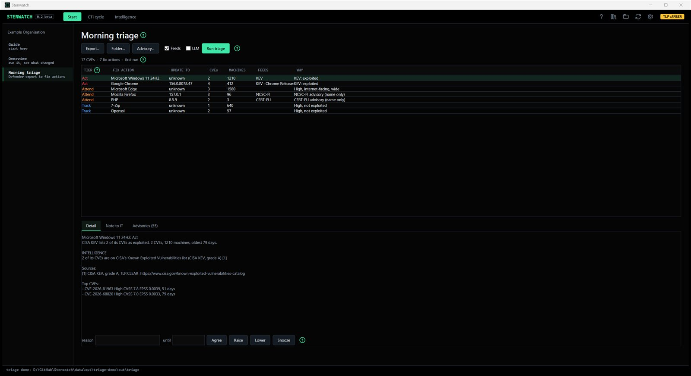
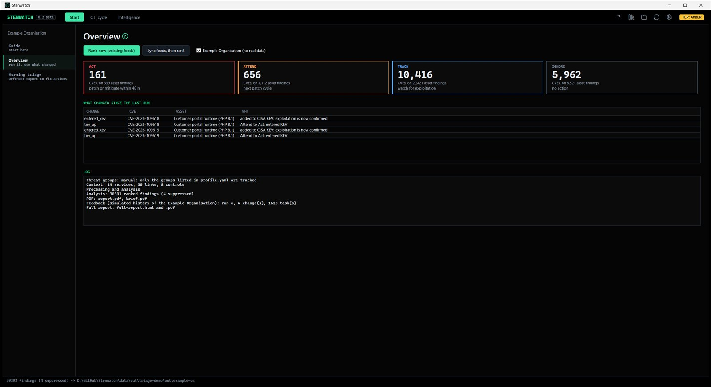
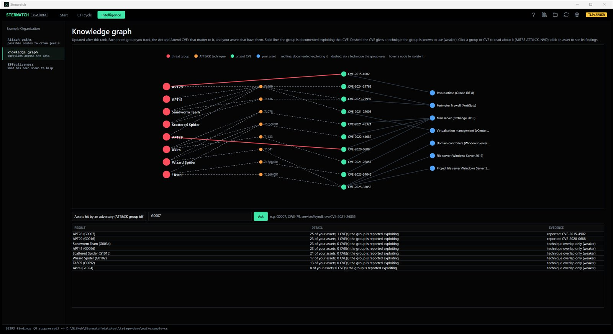
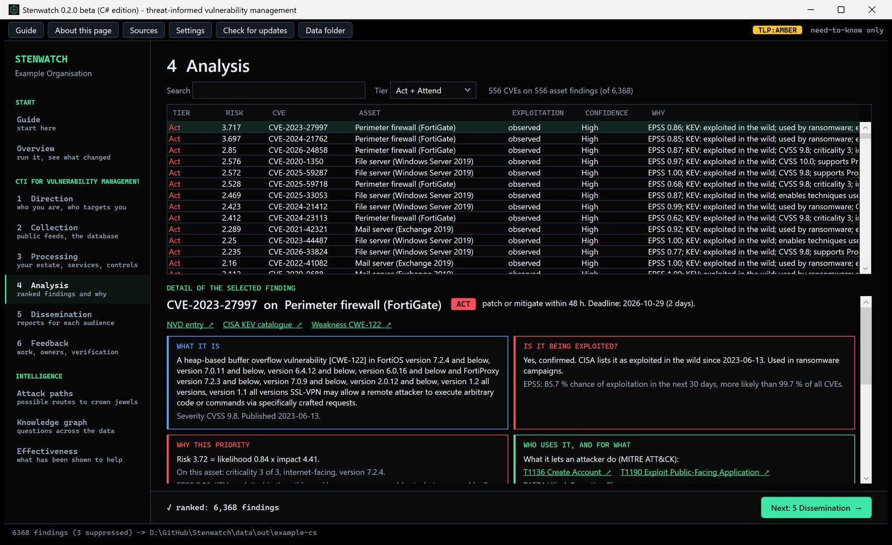
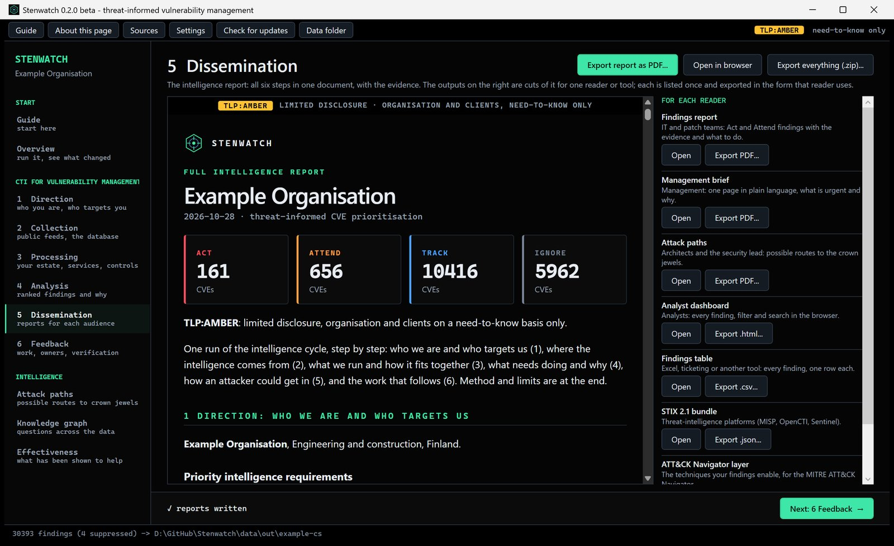

<div align="center">

# Stenwatch

**Threat-informed vulnerability management.**
From every CVE in the world to the few that matter to *your* organisation, with a reason for every decision.


**[Download for Windows (0.2.0 beta) →](https://github.com/idiljot-singh/Stenwatch/releases/tag/v0.2.0-beta)** · **[Live page and films →](https://idiljot-singh.github.io/Stenwatch/)**

</div>

*Stenwatch* is a narrow watch: it watches the whole global vulnerability feed and narrows it to what, in your estate, needs action now, and why.



| Overview: the whole cycle in one click | Knowledge graph: who could use what, where |
|---|---|
|  |  |
| **Analysis: every finding explained** | **Dissemination: one result, every audience** |
|  |  |

<sub>Screenshots use the bundled fictional Example Organisation and example Defender export, not real data.</sub>

## Why

About 40,000 CVEs are published every year. Most teams rank them by CVSS, which measures how bad a flaw *could* be, not whether anyone is using it against *you*. Stenwatch answers three questions instead:

1. **Do we run it?** Your assets are matched to every CVE by product (CPE) and version.
2. **Do our suppliers run it?** MSPs, SaaS and partners are weighted by the data they hold and the access they have.
3. **Are the attackers who target us using it?** Known exploitation (CISA KEV), predicted exploitation (FIRST EPSS), and the threat groups that target your sector and country (MITRE ATT&CK with the CTID mappings).

Every finding gets one of four decisions: **Act** (within 48 h) · **Attend** (next patch cycle) · **Track** · **Ignore**.

## Morning triage: your Defender export, ranked

Microsoft Defender lists every CVE on your devices, but with CVSS alone hundreds look urgent and its own exploit flags are often empty. **Morning triage** takes Defender's *Vulnerabilities → Export* file as it is and turns it into a short list of **fix actions** ("update Chrome to 156.0.8078.47: 4 CVEs, 412 machines"), each with a tier and the rule that set it:

- **Act** if CISA KEV lists one of its CVEs, or a grade A–B source says it is actively exploited (English or Finnish wording).
- **Attend** if an advisory names it, a working exploit exists, MITRE ATT&CK links a threat group to it, EPSS is 5 % or more, or it is high severity on an internet-facing product on 100+ machines.
- **Track** / **Ignore** otherwise.

It reads free sources each morning: **NCSC-FI, CERT-EU, CISA, Microsoft MSRC (exploited CVEs) and Chrome Releases**, and any RSS or Atom feed you add, each with a reliability grade and a TLP. Every fix action gets an **intel card** of cited lines (what the sources say, [n] = which source). You can mark a row Agree, Raise, Lower or Snooze; the mark is kept for tomorrow, and tomorrow's run shows what changed. Outputs: a one-page briefing, an Excel file and a ready-to-send note to IT.

An optional LLM (OpenRouter's free model, or a model on your own machine) reads advisories that name no CVE, including Finnish ones, writes the intel card and the IT note. It **never sets a tier**, a claim is kept only if the source text contains it, and TLP:AMBER text goes only to a local model. The ladder is a fixed rule set and has **not been validated against outcomes**. Try it on [`examples/defender-export.example.csv`](examples/defender-export.example.csv); guide: [MORNING-TRIAGE.md](docs/guides/MORNING-TRIAGE.md).

## Install

1. Download `Stenwatch-Setup-0.2.0-beta.exe` from the [release page](https://github.com/idiljot-singh/Stenwatch/releases/tag/v0.2.0-beta) and run it. No admin rights; .NET is included.
2. The beta is unsigned, so Windows shows a blue "unknown publisher" screen: choose **More info → Run anyway**, or ask IT to allow-list the file by its SHA-256 (in the release notes).
3. The app opens on **Guide**. The toolbar has three workspaces: **Start** (Guide, Overview, Morning triage), **CTI cycle** (the six steps) and **Intelligence**. Tick **Example Organisation** on Overview to try every page with fictional data, or open Morning triage with your Defender export. Every **?** explains the thing next to it.

Your files live in `%APPDATA%\Stenwatch` and survive updates. To update, use **Check for updates** in the toolbar, or run the newer Setup over the old one.

## How it works: the intelligence cycle

The **CTI cycle** workspace is the intelligence lifecycle. Each step shows at the bottom what it still needs; the **Next** button turns green when it is done.

| Step | What you do | What Stenwatch does |
|---|---|---|
| **1 Direction** | Import `profile.yaml` (who you are, who targets you) and your asset list | Picks the threat groups that matter to your sector and country, with the reason for each |
| **2 Collection** | Sync the feeds, or only CVEs changed since a date (cancel any time) | Downloads NVD, CISA KEV, FIRST EPSS, MITRE ATT&CK and D3FEND, CTID mappings into a local database |
| **3 Processing** | Optional: services, crown jewels, links, controls, mostly picked from lists | Matches every CVE to your assets; services raise impact, evidenced controls lower likelihood |
| **4 Analysis** | Read the findings; record a decision (patched, mitigated, accepted) | Scores `risk = likelihood × impact`, and explains each finding with its evidence and confidence |
| **5 Dissemination** | Open or export | Full intelligence report, findings report, management brief (HTML and PDF), dashboard, CSV, STIX 2.1, ATT&CK Navigator layer |
| **6 Feedback** | Assign tasks, claim fixes | Turns priorities into tasks with deadlines; a fix counts only when a later run no longer finds the CVE |

The **Intelligence** workspace fills in after every rank: a knowledge-graph map (threat group → technique → CVE → your asset, with links to MITRE ATT&CK and NVD), possible attack paths to your crown jewels, and what has been shown to help.

```
likelihood = 0.4·EPSS + 0.3·in KEV + 0.1·ransomware + 0.2·used by a tracked threat group
impact     = CVSS/10 · asset criticality (or supplier blast radius) · exposure
risk       = likelihood · impact            all weights live in profile.yaml
```

### Your asset list

Either Stenwatch's own format (`name,cpe,version,criticality,internet_facing`, see [`examples/assets.example.csv`](examples/assets.example.csv)) or **an inventory export as it is**: one row per host with columns such as `hostname, vendor, product, version, os`. Stenwatch looks each OS and product up in NVD's own product list, makes one asset per product and version, and lists the hosts it could not match. Add an `os_build` column (Intune, SCCM and Defender all export it) and patched CVEs drop out exactly; without one, `patch_baseline` in `profile.yaml` is an optional, clearly labelled assumption.

## Features

| | |
|---|---|
| **Morning triage** | Defender export → fix actions with tier, reason, cited sources, your marks and a daily diff |
| **Graded, TLP-aware sources** | National CERTs, CISA, Microsoft, Chrome and your own feeds, each with a grade and a TLP |
| **Threat-informed** | Ranks by what the groups that target *your* sector and country actually use, not by severity alone |
| **Explainable** | Every priority shows its evidence, the public source, how confident Stenwatch is, and the formula. The same inputs give the same ranking; an optional LLM only reads and writes text (brief, advisories, intel cards), never ranks |
| **Business context** | Services, crown jewels, links between assets and controls that count only while their evidence is dated and current |
| **Attack paths and knowledge graph** | Possible routes from the internet to your crown jewels; which group could use which CVE on which asset |
| **Defend** | Every finding lists MITRE D3FEND countermeasures and ATT&CK mitigations |
| **Suppliers** | Third-party CVEs weighted by data access and privileged access |
| **Outputs for each audience** | Full report, findings report, brief, dashboard, CSV, STIX 2.1 for MISP, OpenCTI or Sentinel, ATT&CK Navigator layer |
| **Private by design** | Runs on your machine; only public feeds are downloaded; secrets in Windows Credential Manager; outputs marked TLP:AMBER |

## Stenwatch and Microsoft Defender Vulnerability Management

They do different jobs and work well together. Defender's agent knows exactly which software and patch level each enrolled device has. Stenwatch does not scan: it ranks what you run by what is being exploited, by whom, and how that matters to your business, shows its working for every decision, covers what has no agent (network devices, appliances, suppliers), and writes reports for each audience. Stenwatch can read Defender's device inventory (the `defender` section of `profile.yaml`), which removes the guesswork about patch levels, and **Morning triage** reads Defender's vulnerability export directly. Whether Stenwatch's ranking finds the exploited CVEs earlier than other methods has not been shown yet; see [what has and has not been shown to help](docs/evaluation.md).

## Build from source

```bash
dotnet test src/Stenwatch.Tests                          # needs the .NET 8 SDK
dotnet run --project src/Stenwatch.App                   # the desktop app
dotnet run --project src/Stenwatch.Cli -- --example      # command line, Example Organisation
dotnet run --project src/Stenwatch.Cli -- --convert-inventory   # inventory export -> assets.csv
installer\build-cs.bat                                   # tests, then the installer (needs Inno Setup 6)
```

The original Python edition (0.1) is retired. It is kept in git history under the tag `python-edition-0.1`.

## Repository map

```
Stenwatch/
  src/         Stenwatch 0.2 desktop app (Core, App, Cli, Tests) -> src/README.md
  examples/    the fictional Example Organisation          -> examples/README.md
  data/        YOUR files: profile, assets, cve.db, out/   -> data/README.md  (git-ignored)
  docs/        pillars, evaluation, ADRs, guides, live page -> docs/README.md
  installer/   Windows installers and build scripts        -> installer/README.md
  tools/       diagram and metrics generators
  cloud/ saas/ the hosted-demo experiment (hybrid SaaS, ADR 0001)
```

## Documentation

| Document | Read it to… |
|---|---|
| [The 15 pillars](docs/pillars.md) | See what CTI-driven vulnerability management needs and where Stenwatch stands on each |
| [Evaluation](docs/evaluation.md) | Know what has and has not been shown to help |
| [CUSTOMISE.md](docs/guides/CUSTOMISE.md) | Set Stenwatch up for **your** organisation, step by step |
| [MORNING-TRIAGE.md](docs/guides/MORNING-TRIAGE.md) | Use the Defender export, sources, grades, TLP and the LLM each morning |
| [WALKTHROUGH.md](docs/guides/WALKTHROUGH.md) ([PDF](docs/guides/WALKTHROUGH.pdf)) | Understand how every stage works and why |
| [SECURITY.md](SECURITY.md) | Report a vulnerability in Stenwatch |

## Your data stays yours

Everything of yours (profile, asset and supplier lists, decisions, the database and every output) lives in your data folder and is **git-ignored** in this repository: it describes where your organisation is vulnerable. Only public feeds are downloaded; nothing about your estate is sent anywhere unless you enable a cloud LLM. Even then only public advisory text and product names go out: no machine counts, no sector or country, no TLP:AMBER or RED text (those go to a local model only, or nowhere), and pasted mail is redacted.

## Author

**Stenwatch** is created and maintained by **Diljot Singh Johal**. If you use it in research or in your organisation, please cite it (see [CITATION.cff](CITATION.cff)).

## License

[MIT](LICENSE) © 2026 Diljot Singh Johal.
Feed data belongs to its publishers: NIST NVD, CISA, FIRST, MITRE and the Center for Threat-Informed Defense. Check their terms before redistributing it.
